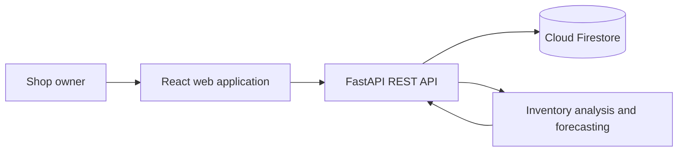

# StockRadar

### Run your shop. Grow your business.

**Simple inventory management and intelligent business insights for African retailers.**

   

## About StockRadar

StockRadar is an independent software project designed to help small retailers, kiosks and local shop owners manage their stock, record sales and reduce avoidable inventory losses.

Small businesses need to know what is selling, what is running out and which products may expire before they are sold. StockRadar brings this information together in a simple, mobile-friendly interface, turning inventory data into practical everyday advice.

**Built for Africa. Designed for simplicity.**

## Key features

| Feature | Business benefit |
| --- | --- |
| Daily dashboard | See today's sales, gross profit, units sold and best sellers. |
| Quick sales | Find products, adjust quantities and record customer purchases. |
| Stock management | Add products, monitor quantities, prices and expiry dates. |
| Stock alerts | Identify slow-selling products, expiry risks and potential restocking needs. |
| Special offers | Set discounts and track sales and inventory cost recovered during an offer. |
| Business advice | Receive practical recommendations based on inventory and sales data. |
| Reports | Review daily performance and access detailed demand forecasts. |
| Language support | Switch between English and Kiswahili; full translation is in progress. |
| Mobile-friendly design | Use large touch controls, bottom navigation and a persistent basket during sales. |

## How it works

StockRadar has three main sections:

- **Home:** Understand how the shop is performing today and see what needs attention.
- **My Stock:** Manage products, record sales and create special offers.
- **Reports:** Review business performance and explore detailed forecasts when needed.

The everyday sales workflow is deliberately simple: **Find a product → Add the quantity → Complete the sale.**

StockRadar records sales; it does not process or verify customer payments.

## Technology stack

| Layer | Technology |
| --- | --- |
| Frontend | React, Vite, CSS |
| Backend | Python, FastAPI |
| Database | Firebase Cloud Firestore |
| Forecasting | Historical sales averages and holdout validation |
| Version control | Git and GitHub |

The application uses Tanzanian shillings (TSh) and East Africa Time for local-day reporting.

## Architecture



## Getting started locally

### Prerequisites

- Python 3, Node.js and npm
- A Firebase project with Cloud Firestore enabled
- Firebase Admin SDK credentials for a disposable development project

### 1. Clone the repository

```bash
git clone https://github.com/Gablufie/stockradar.git
cd stockradar
```

### 2. Start the backend

```bash
cd backend
python3 -m venv venv
source venv/bin/activate
pip install fastapi uvicorn firebase-admin pydantic
```

Configure Firebase Admin SDK credentials using the existing backend configuration. For the local service-account setup, place your own `serviceAccountKey.json` in the backend directory. Never commit this file or other private credentials.

```bash
uvicorn main:app --reload
```

The API runs at `http://127.0.0.1:8000` by default. Interactive API documentation is available at `/docs`.

### 3. Start the frontend

Open a separate terminal from the repository root:

```bash
cd frontend
npm install
npm run dev
```

Open `http://localhost:5173` in your browser. If needed, set `VITE_API_BASE=http://127.0.0.1:8000` in your local frontend environment configuration.

## Testing

Run the forecast unit tests from the backend directory:

```bash
python -m unittest test_forecast -v
```

Run the frontend production build from the frontend directory:

```bash
npm run build
```

Development testing has included six forecast unit tests, successful frontend production builds, mobile browser emulation and a demonstrated quick-sale checkout. Use disposable test inventory to verify stock updates, undo, expiry restrictions, insufficient stock, special offers and daily reporting.

## Development status and roadmap

StockRadar is a working prototype, not yet a production-ready service.

- [x] Core inventory and sales management
- [x] Inventory analysis and demand forecasting
- [x] Persistent special offers
- [x] Simplified dashboard and navigation
- [x] Responsive mobile interface and quick sales
- [ ] Complete English and Kiswahili localization
- [ ] Authentication and private shop accounts
- [ ] Security hardening and integration testing
- [ ] Online deployment
- [ ] Usability testing with local shop owners

### Current limitations

Inventory risk scores are heuristic and forecasts are estimates, not guarantees. Simulated demonstration data is separate from live inventory. Checkout uses transactions, but other inventory operations require further concurrency review. Authentication, shop-level data isolation and comprehensive security testing remain pending. Do not use the current prototype with real confidential business data or expose its unauthenticated API publicly.

## Project philosophy

Technology should simplify the work of a shop owner, not create more work. StockRadar prioritizes clear language, accessible controls and useful recommendations over unnecessary complexity.

Developed independently as a software engineering portfolio project by [Gablufie](https://github.com/Gablufie).
